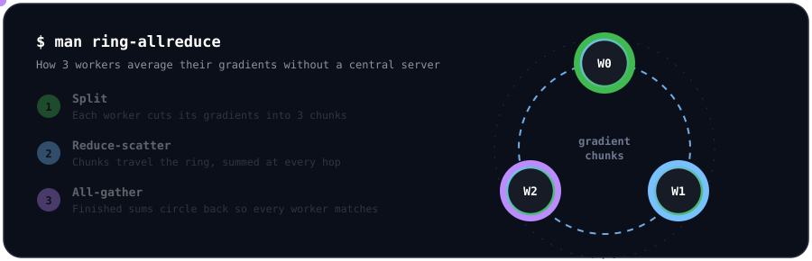

  

  
  
  
  

  

  
  
  
  

click a panel to open the repo

<code>$ man ring-allreduce</code>  how my distributed trainer works

 

I wrote the Ring-AllReduce from scratch over gRPC. Training survived 200 injected failures, and the final weights match serial training to 7.77e-16. <a href="https://github.com/brindhas110404/fault-tolerant-distributed-ml-training/blob/main/FINAL_REPORT.md">Read the report</a>.

<code>$ ls ~/services --all</code>  more projects

 

- [smartai](https://github.com/brindhas110404/smartai) ([live](https://smartai-omega-two.vercel.app/)): a Gemini planner that routes each request to chat, code, image, voice or vision tools and chains up to three steps.
- [real-time-vision-assistant](https://github.com/brindhas110404/real-time-vision-assistant): object detection and face recognition streams in Flask with OpenCV, TinyYOLOv3 and dlib.
- [icu-patient-phenotyping](https://github.com/brindhas110404/icu-patient-phenotyping): clustering MIMIC-IV ICU stays, with prediction leakage called out explicitly (course group project).
- [reelyai](https://github.com/brindhas110404/reelyai): short reels from uploaded media with AI narration and background video jobs.
- [papermind](https://github.com/brindhas110404/papermind): question answering over research papers with vector search.

  

  

also: gRPC · Paxos · two-phase commit · RAG · vector search · Gemini · Llama · learning CUDA and Nsight

 

  

  

  

<code>$ exit</code>  thanks for stopping by

